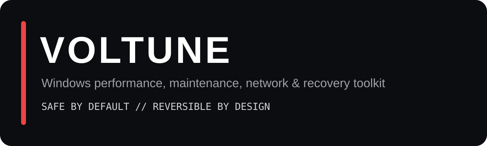

<p align="center">
  
</p>

# Voltune

**Universal Hardware-Aware Windows Performance, Gaming, Maintenance & Recovery Toolkit.**

Voltune v3.0 Ultimate mengadopsi model distribusi instan one-liner ala Chris Titus Tech (`winutil`), dilengkapi **Modern Native WPF GUI Desktop Hub**, **Hardware-Aware Display & Game Auto-Configurator**, **TCP/IP Gaming Latency Optimizer (Zero-VPN Harm)**, **Windows Services Optimizer**, **Windows Update Security-Only Lock**, serta pembersih disk lintas-drive **VoltClean** dan pemulihan 1-klik **VoltUndo**.

> **Safe by default. Reversible by design. 100% Dynamic. Zero VPN harm.**

---

## ⚡ Quick Start: One-Liner (Tanpa Install)

Cukup buka **PowerShell (Run as Administrator)** dan jalankan satu baris perintah berikut:

```powershell
irm https://raw.githubusercontent.com/rzqllh/Voltune/main/voltune.ps1 | iex
```

Atau jalankan secara lokal dari direktori repositori:
```powershell
# Jalankan menu interaktif Terminal (TUI)
.\voltune.ps1

# Atau buka Modern Native WPF Desktop Window (GUI)
.\voltune.ps1 -GUI
```

---

## 🚀 Fitur Unggulan v3.0 (Ultimate)

1. **Modern Native WPF Desktop GUI (`-GUI` / Hotkey `G`):**
   - Tampilan grafis modern bertema dark mode dengan telemetri hardware real-time.
   - Tab navigasi lengkap: Dashboard, Gaming & VoltPlay, QoL & Privasi, Software & Runtimes, VoltClean, System Health, dan VoltUndo.
   - Berjalan murni di atas runtime .NET bawaan Windows (tanpa dependensi eksternal).
2. **Dynamic Hardware & Game Ecosystem Engine:**
   - Deteksi otomatis arsitektur CPU Intel (Hybrid P+E Cores) dan AMD Ryzen.
   - Dual-GPU Parity: Mendeteksi NVIDIA GeForce RTX (VRAM & TGP Wattage via `nvidia-smi`), AMD Radeon, dan Intel iGPU.
   - Pemindaian Game Lintas-Drive Dinamis: Membaca seluruh library Steam di C: dan D:, HoYoPlay (HSR & Genshin), Rockstar (RDR2), dan CDPR (Cyberpunk / The Witcher 3).
   - Dynamic FPS Capping (VRR TearFree vs Battery Saver).
3. **TCP/IP Gaming Latency Optimizer (Zero-VPN Harm):**
   - Menonaktifkan Nagle's Algorithm (`TcpAckFrequency = 1`, `TCPNoDelay = 1`) pada adapter fisik (Ethernet & Wi-Fi).
   - **Strict Whitelist Safety Guard:** Menjamin adapter virtual, TAP, dan Palo Alto GlobalProtect (`PanGPS`) dilewati secara aman tanpa merusak koneksi VPN perusahaan.
   - Menonaktifkan Network Throttling Index (`0xFFFFFFFF`) & `SystemResponsiveness = 0`.
4. **Windows Services Optimizer (Safe Gaming Profile):**
   - Mengoptimalkan layanan latar belakang bloat (`DiagTrack`, `dmwappushservice`, `MapsBroker`, `lfsvc`, `RemoteRegistry`, Xbox on-demand).
   - Layanan audio, printing, dan network VPN tetap terjaga 100%.
5. **Windows 11 QoL & Deep Privacy:**
   - Classic Right-Click Context Menu (Windows 10 style).
   - File Explorer Pro (tampilkan ekstensi file, buka ke This PC, tampilkan hidden files).
   - Taskbar Clean (sembunyikan Widgets RAM hog, Copilot, & Task View).
   - Matikan Windows Recall AI snapshot (Win11 24H2), Copilot system-wide, dan iklan Start Menu.
6. **Windows Update Control (Security Updates Only):**
   - Menunda feature update tahunan 365 hari agar OS selalu stabil.
   - Mencegah restart mendadak saat user aktif bekerja (`NoAutoRebootWithLoggedOnUsers = 1`).
   - Memblokir pembajakan driver GPU/Audio oleh Windows Update.
7. **Game Runtimes & Software Catalog (WinGet One-Click):**
   - 1-Klik pasang Visual C++ 2005-2022 AIO (x86 & x64), DirectX Runtimes, dan .NET Desktop Runtime.
   - Katalog instalasi software terkurasi: Steam, Discord, OBS, RTSS, VS Code, Git, Terminal, Everything.
   - Selective Appx Debloater untuk menghapus bloatware bawaan (BingNews, Weather, Solitaire, Clipchamp).
8. **VoltClean Cross-Drive Cleaner:**
   - Membersihkan `%TEMP%`, `C:\Windows\Temp`, shader cache multi-vendor (NVIDIA, AMD, Intel, DirectX), shader Steam di semua drive (C: & D:), crash dumps, dan Recycle Bin.
   - Dilindungi Dynamic Process Guard (melewati file yang sedang dikunci game/browser aktif).
9. **System Health & Diagnostic Suite:**
   - SFC /scannow, DISM RestoreHealth, DISM Component Store ResetBase.
   - 1-Klik Reset Windows Update, 1-Klik Reset Network & Winsock catalog, Rebuild Icon cache, dan Trim Standby Memory.
10. **VoltUndo (1-Klik Pemulihan Total & System Restore):**
    - Otomatis membuat Windows System Restore Point dan snapshot registri (`.reg`) serta file config (`.bak`).
    - 1-Klik Undo mengembalikan seluruh settingan ke kondisi awal dengan sempurna.

---

## Tampilan Antarmuka (CLI / TUI)

```text
================================================================================
                       ⚡ VOLTUNE WINDOWS UTILITY v2.0 ⚡
                 Bikin Laptop & PC Gaming Lu Lebih Ngacir & Stabil
================================================================================

[SPEK LAPTOP LU TERDETEKSI]
 • Prosesor  : 12th Gen Intel Core i7-12650H (10 Cores, 16 Threads | Hybrid P+E)
 • Kartu GPU : NVIDIA GeForce RTX 4060 Laptop GPU (8 GB VRAM)
 • Layar     : 1920x1080 @ 144 Hz
 • Memori    : 16 GB RAM
 • Ruang C:  : 85.5 GB Bebas
 • Status HAGS: Aktif [✓]
 • Game Nemu : Red Dead Redemption 2, Honkai: Star Rail, Genshin Impact, The Witcher 3

--------------------------------------------------------------------------------
 PILIH TINDAKAN (Ketik angka lalu tekan Enter):
--------------------------------------------------------------------------------
 [1] 🚀 Optimasi Otomatis (Rekomendasi - Terima Beres)
 [2] 🎮 Sesuaikan Setting Game Khusus (RDR2 / HSR / Genshin / Witcher)
 [3] 🧹 Bersihkan File Sampah & Ruang Disk (VoltClean)
 [4] 🛠️ Buka Fitur Lanjutan Voltune (DNS, DISM, SFC)
 [5] ↩️ Kembalikan Semua Settingan ke Semula (Undo / Reset)
 [0] Keluar
================================================================================
```

## Why Voltune?

Windows tuning scripts often mix useful maintenance with undocumented tweaks, assume commands succeeded, and provide no way back. Voltune takes a different approach:

- **Safe Mode by default** keeps experimental changes out of normal workflows.
- **State-aware sessions** remember what changed and restore previous state where practical.
- **Verified mutations** avoid printing success just because a command was launched.
- **Real DNS benchmarking** measures DNS queries rather than pretending ICMP ping equals resolver performance.
- **Crash recovery** detects an unfinished Gaming Session on the next launch.
- **Audit logs** record system-changing actions per session.

## Highlights

| Area | What Voltune does |
| --- | --- |
| Gaming | Preflight, temporary background cleanup, power-plan switch, automatic restore |
| Power | Balanced, High Performance, Power Saver, verified Ultimate Performance creation |
| Storage | Safe cache cleanup, interactive disk analyzer, developer-artifact cleanup, installer hunting |
| Network | Safe repair, destructive reset behind confirmation, diagnostics, traceroute |
| DNS | Real-query benchmark, median/P95/success ranking, switch, verify, restore |
| Startup | Toggle common Run entries and inspect startup Scheduled Tasks |
| Apps | Appx manager, WinGet updates, desktop-app inventory, registered-uninstaller launcher |
| System | CIM-based hardware/OS dashboard, health checks, Defender status, live monitor |
| Recovery | Snapshots, history, Gaming Session crash recovery, restore-point helper |
| Advanced | Experimental network/BCD controls and explicit memory tools |

See [docs/FEATURES.md](docs/FEATURES.md) for the complete feature map.

## CLI layout

```text
VOLTUNE // Windows utility

PERFORMANCE
 [1] Gaming Session          Temporary gaming cleanup + automatic restore
 [2] Gaming Preflight        Read-only readiness check before gaming
 [3] Power Plans             Balanced / High / Ultimate / Power Saver
 [4] Performance Settings    Conservative visual and Game DVR controls

MAINTENANCE
 [5] Storage Cleanup         Preview first, then selective cache/temp cleanup
 [6] Startup Manager         Control common sign-in startup entries
 [7] App Manager             Detect and remove selected optional Appx apps
 [8] App Updates             Preview WinGet updates before installing
 [9] Component Cleanup       Separate DISM component-store maintenance
 [22] Disk Analyzer          Interactive folder-size and large-file explorer
 [23] Developer Cleanup      node_modules / venv / build artifact cleanup
 [24] Installer Cleanup      Stale installer and installer-archive finder
 [25] Smart Uninstaller      Desktop app inventory + conservative leftovers

NETWORK
 [10] DNS Benchmark & Switch Real DNS-query benchmark + apply + restore
 [11] Network Diagnostics    Router / internet / DNS / route checks
 [12] Latency Monitor        Average / jitter / packet loss
 [13] Network Repair         Safe repair or explicit destructive reset

SYSTEM
 [14] System Dashboard       Hardware, OS, network, security and power overview
 [15] System Health          Read-only health summary
 [16] Windows Defender       Defender status and maintenance actions
 [17] Process Inspector      CPU / RAM / disk process visibility
 [26] Live System Monitor    Continuously refreshed system metrics

PRIVACY & RECOVERY
 [18] Privacy Controls        Snapshotted recommended privacy settings
 [19] Restore & History       Inspect and restore supported changes
 [27] Protected Paths         Persistent filesystem deletion whitelist

ADVANCED
 [20] Experimental Tweaks    Locked while Safe Mode is enabled
 [21] Memory Tools            Explicit troubleshooting operations

 [H] Help                  Plain-language explanation of every feature
 [M] Safe / Advanced       Toggle access to higher-impact tools
 [D] Dry Run               Simulate supported changes
 [0] Exit
```

### Direct CLI / automation

The menu remains the default, but Voltune now exposes script-friendly read-only and cleanup surfaces:

```powershell
voltune status
voltune status --json
voltune status --watch --ndjson
voltune analyze $HOME --large --threshold-mb 1000 --json
voltune dev-clean                 # dry-run by default
voltune dev-clean --apply         # deletes only eligible non-recent artifacts
voltune installers --json
voltune apps --json
voltune history --json
```

`dev-clean` is intentionally dry-run unless `--apply` is supplied. Machine-readable commands do not decorate JSON with Rich output.

Every completed, cancelled, or backed-out feature returns to a freshly cleared main menu. The main loop owns that behavior so individual features do not each reinvent `cls`.

## Requirements

- Windows 11
- PowerShell 5.1 or newer
- Python 3.10+ when running from source
- Administrator privileges for privileged operations
- WinGet only for the App Updates feature

## Run from source

```powershell
git clone https://github.com/<your-username>/voltune.git
cd voltune
py -m venv .venv
.\.venv\Scripts\Activate.ps1
python -m pip install -r requirements.txt
python .\run_voltune.py
```

Or install the package in editable mode:

```powershell
python -m pip install -e .
voltune
```

## Configuration

On first run Voltune creates local `config.json`, `state.json`, and `logs/`. They are deliberately ignored by Git.

Use [`config.example.json`](config.example.json) as the documented baseline for DNS providers, Gaming Session process/service lists, startup targets, and UI defaults.

## Build a Windows EXE

You do **not** need to build Voltune just to develop it. Run `python .\run_voltune.py` while developing. Build the EXE when you want a portable binary or a release artifact.

Install the build dependencies:

```powershell
python -m pip install -r requirements-dev.txt
```

Recommended build:

```powershell
powershell -ExecutionPolicy Bypass -File .\build.ps1
```

> **0.2.1 packaging fix:** the repository root must **not** contain a legacy `voltune.py`. That filename shadows the real `src\voltune` package during PyInstaller analysis. Use `run_voltune.py` for source launches and `build.ps1` for the EXE.

Short alternative, equivalent to the old `HAFIZH_TOOLKIT.py` style command:

```powershell
python -m PyInstaller --noconfirm --clean Voltune.spec
```

The executable is created at `dist\Voltune.exe`. Test that exact EXE on Windows before publishing it.

For tagged releases, GitHub Actions builds the executable automatically, generates `SHA256SUMS.txt`, and attaches both to the Release. See [docs/BUILD.md](docs/BUILD.md) for the full local-build, verification, SmartScreen, checksum, and release flow.

## After publishing to GitHub

Before calling the repository release-ready, complete the [post-deployment checklist](docs/POST_DEPLOYMENT.md). It covers repository metadata, screenshots, Actions, security checks, the first tagged release, EXE verification, checksums, and the unsigned-binary/SmartScreen note.

## Safety

Filesystem deletion now flows through a centralized safety engine. It blocks filesystem/system roots, symlinks and Windows reparse points by default, respects persistent protected paths, supports narrow authorized cleanup scopes, and verifies deletion results. Disk Analyzer deletion is additionally locked behind Advanced Mode.

Voltune can change privileged Windows configuration. Read [docs/SAFETY.md](docs/SAFETY.md) before using Advanced Mode or destructive network reset. Use normal backups for important systems; a restore history inside a utility is not a replacement for a backup strategy.

## Development

```powershell
python -m pip install -r requirements-dev.txt
python -m pytest
python -m compileall src run_voltune.py
```

The regression tests include checks for bugs that previously mattered to the project: invalid `sc config start=` construction, WMIC dependency, Rich `TaskID.update()` misuse, and accidental reintroduction of the old monolithic “Apply ALL” behavior pattern.

## Project status

Voltune is currently **alpha / portfolio-stage software**. The Windows integrations are designed defensively, but they still need real-machine coverage across different Windows 11 builds, OEM software, VPNs, power models, and managed-device policies.

See [docs/ARCHITECTURE.md](docs/ARCHITECTURE.md) for the current structure and planned domain split. Before tagging a release, use the [Windows integration checklist](docs/WINDOWS_TEST_CHECKLIST.md).

## License

MIT. See [LICENSE](LICENSE).
