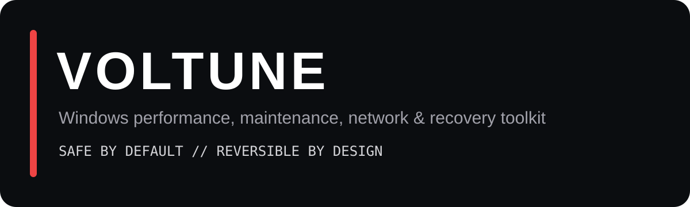

<p align="center">
  
</p>

# Voltune

**A state-aware Windows performance, maintenance, network, and recovery toolkit.**

Voltune is a Python CLI for Windows 11 that groups common maintenance and diagnostic workflows behind one consistent interface. Instead of treating every registry edit as a magical FPS button, it prioritizes detection, verification, logging, and restoration.

> **Safe by default. Reversible by design.**

## Why Voltune?

Windows tuning scripts often mix useful maintenance with undocumented tweaks, assume commands succeeded, and provide no way back. Voltune takes a different approach:

- **Safe Mode by default** keeps experimental changes out of normal workflows.
- **State-aware sessions** remember what changed and restore previous state where practical.
- **Verified mutations** avoid printing success just because a command was launched.
- **Real DNS benchmarking** measures DNS queries rather than pretending ICMP ping equals resolver performance.
- **Crash recovery** detects an unfinished Gaming Session on the next launch.
- **Audit logs** record system-changing actions per session.

## Highlights

| Area | What Voltune does |
| --- | --- |
| Gaming | Preflight, temporary background cleanup, power-plan switch, automatic restore |
| Power | Balanced, High Performance, Power Saver, verified Ultimate Performance creation |
| Storage | Preview and selectively clean temp/cache categories with reclaimed-size reporting |
| Network | Safe repair, destructive reset behind confirmation, diagnostics, traceroute |
| DNS | Real-query benchmark, median/P95/success ranking, switch, verify, restore |
| Startup | Toggle common Run entries and inspect startup Scheduled Tasks |
| Apps | Appx manager and WinGet update preview/install flow |
| System | CIM-based hardware/OS dashboard, health checks, Defender status |
| Recovery | Snapshots, history, Gaming Session crash recovery, restore-point helper |
| Advanced | Experimental network/BCD controls and explicit memory tools |

See [docs/FEATURES.md](docs/FEATURES.md) for the complete feature map.

## CLI layout

```text
VOLTUNE // Windows utility

PERFORMANCE
 [1] Gaming Session          Temporary gaming cleanup + automatic restore
 [2] Gaming Preflight        Read-only readiness check before gaming
 [3] Power Plans             Balanced / High / Ultimate / Power Saver
 [4] Performance Settings    Conservative visual and Game DVR controls

MAINTENANCE
 [5] Storage Cleanup         Preview first, then selective cleanup
 [6] Startup Manager         Control common sign-in startup entries
 [7] App Manager             Detect and remove selected optional Appx apps
 [8] App Updates             Preview WinGet updates before installing
 [9] Component Cleanup       Separate DISM component-store maintenance

NETWORK
 [10] DNS Benchmark & Switch Real DNS-query benchmark + apply + restore
 [11] Network Diagnostics    Router / internet / DNS / route checks
 [12] Latency Monitor        Average / jitter / packet loss
 [13] Network Repair         Safe repair or explicit destructive reset

SYSTEM
 [14] System Dashboard       Hardware, OS, network, security and power overview
 [15] System Health          Read-only health summary
 [16] Windows Defender       Defender status and maintenance actions
 [17] Process Inspector      CPU / RAM / disk process visibility

PRIVACY & RECOVERY
 [18] Privacy Controls        Snapshotted recommended privacy settings
 [19] Restore & History       Inspect and restore supported changes

ADVANCED
 [20] Experimental Tweaks    Locked while Safe Mode is enabled
 [21] Memory Tools           Explicit troubleshooting operations

 [H] Help                  Plain-language explanation of every feature
 [M] Safe / Advanced       Toggle access to higher-impact tools
 [D] Dry Run               Simulate supported changes
 [0] Exit
```

Every completed, cancelled, or backed-out feature returns to a freshly cleared main menu. The main loop owns that behavior so individual features do not each reinvent `cls`.

## Requirements

- Windows 11
- PowerShell 5.1 or newer
- Python 3.10+ when running from source
- Administrator privileges for privileged operations
- WinGet only for the App Updates feature

## Run from source

```powershell
git clone https://github.com/rzqllh/Voltune.git
cd voltune
py -m venv .venv
.\.venv\Scripts\Activate.ps1
python -m pip install -r requirements.txt
python .\voltune.py
```

Or install the package in editable mode:

```powershell
python -m pip install -e .
voltune
```

## Configuration

On first run Voltune creates local `config.json`, `state.json`, and `logs/`. They are deliberately ignored by Git.

Use [`config.example.json`](config.example.json) as the documented baseline for DNS providers, Gaming Session process/service lists, startup targets, and UI defaults.

## Build a Windows EXE

You do **not** need to build Voltune just to develop it. Run `python .\voltune.py` while developing. Build the EXE when you want a portable binary or a release artifact.

Install the build dependencies:

```powershell
python -m pip install -r requirements-dev.txt
```

Recommended build:

```powershell
python -m PyInstaller --noconfirm --clean --onefile --uac-admin --name "Voltune" --paths src voltune.py
```

Short alternative:

```powershell
python -m PyInstaller voltune.py --onefile --uac-admin --name "Voltune" --paths src
```

The executable is created at `dist\Voltune.exe`. Test that exact EXE on Windows before publishing it.

For tagged releases, GitHub Actions builds the executable automatically, generates `SHA256SUMS.txt`, and attaches both to the Release. See [docs/BUILD.md](docs/BUILD.md) for the full local-build, verification, SmartScreen, checksum, and release flow.

## After publishing to GitHub

Before publishing a release, complete the [Windows integration checklist](docs/WINDOWS_TEST_CHECKLIST.md) and follow the release steps in [BUILD.md](docs/BUILD.md). Verify the downloadable EXE and its SHA-256 checksum on a real Windows machine.

## Safety

Voltune can change privileged Windows configuration. Read [docs/SAFETY.md](docs/SAFETY.md) before using Advanced Mode or destructive network reset. Use normal backups for important systems; a restore history inside a utility is not a replacement for a backup strategy.

## Development

```powershell
python -m pip install -r requirements-dev.txt
python -m pytest
python -m compileall src voltune.py
```

The regression tests include checks for bugs that previously mattered to the project: invalid `sc config start=` construction, WMIC dependency, Rich `TaskID.update()` misuse, and accidental reintroduction of the old monolithic “Apply ALL” behavior pattern.

## Project status

Voltune is currently **alpha software**. The Windows integrations are designed defensively, but they still need real-machine coverage across different Windows 11 builds, OEM software, VPNs, power models, and managed-device policies.

See [docs/ARCHITECTURE.md](docs/ARCHITECTURE.md) for the current structure and planned domain split. Before tagging a release, use the [Windows integration checklist](docs/WINDOWS_TEST_CHECKLIST.md).

## License

MIT. See [LICENSE](LICENSE).
