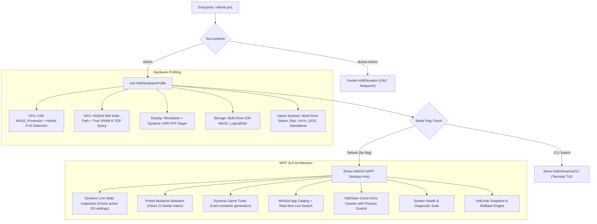

# Voltune Architecture Specification (v3.3.0-Universal)

Dokumen ini menjelaskan arsitektur teknis, alur eksekusi, dan prinsip desain Voltune v3.3.

---

## 1. Desain Arsitektur & Model Distribusi

Voltune dirancang sebagai **Universal Single-File Utility** (`voltune.ps1`) yang dapat dijalankan secara instan via one-liner web maupun secara lokal:

```text
irm https://raw.githubusercontent.com/rzqllh/Voltune/main/voltune.ps1 | iex
```

### Karakteristik Utama Arsitektur:
1. **Zero External Dependencies:** Tidak memerlukan instalasi runtime pihak ketiga (Python, Node.js, atau pustaka binary compiled). Beroperasi 100% menggunakan Windows PowerShell 5.1 / PowerShell 7 dan subsistem .NET framework bawaan Windows (`PresentationFramework`, `PresentationCore`, `WindowsBase`, `System.Windows.Forms`).
2. **Strict Encoding Standard:** Seluruh berkas skrip menggunakan encoding **UTF-8 with BOM (`utf-8-sig`)** untuk menjamin kestabilan parser Windows PowerShell 5.1 saat memproses karakter Unicode/simbol.
3. **Default GUI Launch with Fallback CLI:** Default eksekusi langsung menampilkan Modern Native WPF GUI. Mode terminal interaktif tetap tersedia melalui argumen `-CLI`.

---

## 2. Diagram Alur Eksekusi (Execution Pipeline)



---

## 3. Komponen Inti (Core Subsystems)

### A. Dynamic Hardware Profiler (`Get-VoltHardwareProfile`)
- **Hybrid CPU Detection:** Menganalisis rasio core vs thread pada prosesor Intel Generasi ke-12 ke atas dan AMD Ryzen untuk mendeteksi arsitektur Hybrid P+E Core.
- **True VRAM & Laptop TGP Resolver:**
  - WMI 32-bit `Win32_VideoController.AdapterRAM` meng-clamp nilai VRAM di atas 4 GB menjadi tepat 4 GB (`4,294,967,295` bytes). Voltune mengatasinya dengan memprioritaskan query langsung ke driver GPU NVIDIA via `nvidia-smi` pada multi-path (`C:\Windows\System32\nvidia-smi.exe` dan `C:\Program Files\NVIDIA Corporation\NVSMI\nvidia-smi.exe`).
  - Pada GPU laptop, query standar `power.limit` sering kali mengembalikan nilai `[N/A]`. Voltune secara cerdas menanyakan `enforced.power.limit` yang selalu mengembalikan TGP riil (misal 45W).
- **Universal Multi-Drive Game Scanner:** Membaca berkas manifest Steam `libraryfolders.vdf` di seluruh drive lokal, manifest Epic Games Store (`*.item`), registry HoYoPlay, GOG, Ubisoft, dan direktori game mandiri.

### B. Atomic Tweaks Engine (`Set-VoltAtomicTweak`)
- **Granular Execution:** Menggantikan eksekusi monolitik lama. Setiap tweak memiliki ID unik dan fungsi eksekusi atomik:
  ```powershell
  Set-VoltAtomicTweak -TweakId "TweakHAGS" -Enable $true -Hardware $hw
  ```
- **Live State Detection:** Fungsi `Get-VoltLiveTweakStates` membaca status aktual registri sistem Windows sebelum antarmuka dimuat, sehingga pengguna dapat melihat konfigurasi mana yang sudah aktif di PC mereka.
- **Preset Blueprint Matrix (`$Script:VoltPresetMap`):** Presets (*Recommended*, *Laptop Gaming*, *Desktop Max*, *Minimal Privacy*) didefinisikan sebagai matriks kamus boolean 21-item yang komplit, menjamin penggantian preset tidak menyisakan centang yang tidak diinginkan.

### C. Universal Dynamic Game Tuner (`Populate-DynamicGameTunerUI`)
- Daripada menggunakan kontrol XAML statis yang hanya terbatas pada beberapa game, Voltune menggunakan `ItemsControl` / dynamic `StackPanel` (`pnlDynamicGamesContainer`).
- Untuk setiap game yang terdeteksi, Voltune secara dinamis meng-instansiasi kartu WPF bertema Fluent dengan badge platform, path executable, dan kontrol optimasi GPU, Defender Exclusion, serta tuning engine.
- Menyediakan tombol integrasi File Dialog untuk menambahkan game kustom/portabel secara instan.

### D. Safe Network Optimizer (Zero-VPN Harm)
- **Strict Whitelist Architecture:** Optimasi Nagle's Algorithm (`TcpAckFrequency = 1`, `TCPNoDelay = 1`) pada registri TCP/IP hanya menargetkan interface Ethernet dan Wi-Fi fisik aktif.
- **Proteksi VPN Korporat:** Memfilter dan mengecualikan secara eksplisit seluruh adapter virtual, TAP, dan **Palo Alto GlobalProtect (`PanGPS`)**, menjamin koneksi VPN perusahaan tidak terganggu atau terputus.

### E. Reversibility & Rollback Subsystem (`VoltUndo`)
- **Snapshot Generation:** Sebelum perubahan massal dieksekusi, Voltune mengekspor cabang registri sistem terkait (`.reg`) dan mencadangkan berkas konfigurasi game (`.bak`) ke dalam direktori berstempel waktu di `%LOCALAPPDATA%\Voltune\Backups\Snapshot-<Timestamp>\`.
- **System Restore Point:** Secara otomatis memicu cmdlet `Checkpoint-Computer` Windows untuk membuat titik pemulihan sistem resmi.
- **Deterministic Restore:** Fungsi `Restore-VoltSnapshotByPath` mengimpor kembali berkas `.reg` backup menggunakan utilitas bawaan Windows `reg.exe import` dan mengembalikan berkas konfigurasi ke lokasi aslinya.
